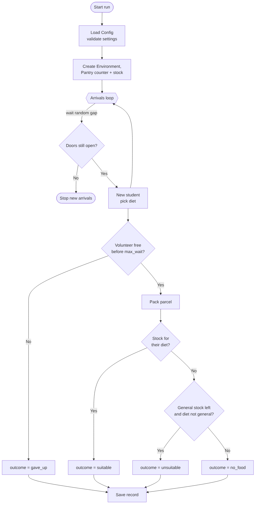

# Design: problem breakdown, pseudocode and flowchart

## 1. Problem decomposition
| Sub-problem | Function / class | Programming concept |
|---|---|---|
| Hold all settings and check them | `Config`, `Config.validate()` | dataclass, selection, exceptions |
| Decide what a student receives | `choose_parcel()` | pure function, selection (if / elif) |
| Run one simulation | `run()` with inner `student()` and `arrivals()` | closures, generators, `simpy.Resource` |
| Turn records into results | `summarise()`, `replicate()` | tuples, Counter, dict, statistics |
| Read scenarios from a file | `load_scenarios()` | file input, csv module, error handling |
| Save and show results | `save_results()`, table in `main()` | file output, f-strings |
| User options | `main()` with `argparse` | command-line interface |

## 2. Pseudocode
```
FOR each scenario:
    validate settings (stop with a clear message if invalid)
    REPEAT reps times with a new seed:
        create pantry with N volunteers and stock per diet
        LOOP:
            wait random time
            IF pantry closed: STOP creating students
            create student with random diet
        FOR each student (running at the same time):
            WAIT for volunteer OR max_wait, whichever first
            IF no volunteer in time: outcome = gave_up
            ELSE:
                pack parcel
                IF stock of their diet > 0: outcome = suitable
                ELSE IF diet != general AND general stock > 0: outcome = unsuitable
                ELSE: outcome = no_food
            record (diet, wait, outcome)
        calculate % per outcome and average wait
    average across repetitions, add 95% confidence interval
print table, save CSV and chart
```

## 3. Flowchart (one student's journey)


## 4. Key design decisions
- **Decision rule as a pure function.** `choose_parcel(stock, diet)` has no SimPy in it, so it can be tested on its own and reused (e.g. in a dashboard) or swapped for a different rule.
- **Own random generator per run.** `random.Random(seed)` instead of the global `random` module: runs cannot affect each other, and scenarios could later run in parallel.
- **No pandas.** The program only needs averages and counts, which `statistics` and `Counter` do. Fewer dependencies, about twice as fast (1.4 vs 2.8 ms per run).
- **Scenarios live in a CSV file, not in code.** A coordinator changes `scenarios.csv` in Excel without touching Python. This also makes file input central to the program.
- **Simplified (Stage 8).** Removed logging, the chart, and extra command-line options. Each one added code and a dependency without changing what the model can answer. The chart now lives on the project web page.
- **Separate stock per diet group.** A single stock number would hide the problem the project is about.
- **"Unsuitable" is a separate outcome.** Giving a halal-needing student general food is not a success, so it is not counted as one.
- **Same seeds across scenarios.** Each scenario uses seeds 42, 43, ... so they face the same arrival pattern. This makes comparisons fairer (common random numbers).
- **Repetitions + confidence interval.** One run is noise. 20 runs and a 95% CI show whether a difference is real.
